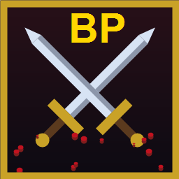

# Bloody Pixels 🗡️🩸 v1.0



Пиксельный рыцарский файтинг в духе **Bloody Bastards** на чистом C# без движка и библиотек.
**Релиз:** 6 стран × 5 этапов, 8 оружий, 14 товаров, повторы боёв, честное «Вдвоём».

## Запуск

```powershell
cd C:\Lfall\PixelFight
dotnet run
```

Нужен только [.NET 8 SDK](https://dotnet.microsoft.com/download) для сборки. Откроется **на весь экран** (F11 — окно/экран).

## Порт Windows (готовые .exe)

В папке `Publish/Games` лежат собранные игры — каждая своим `.exe` (Knights.exe и т.д., .NET уже внутри — ставить ничего не надо). Двойной клик — и игра. Там же удобные архивы `<Игра>-win64.zip` (распаковал и играй) и `src.zip` (исходники). Сейвы живут в `%APPDATA%\PixelFight\save.cfg`. Пересобрать всё:

```powershell
powershell -ExecutionPolicy Bypass -File pack_games.ps1
```

Управление (тач): палец по арене — прицел меча, быстрый тап — рывок/клик, кнопки ◀ ▶ ▲ — движение, 🛡 — блок (держать), 👟 — пинок, 🗡 — смена оружия, 🧪 — зелье. В конце матча тап — заново, дабл-тап — повтор. Пауза — кнопкой II в углу. Иконка приложения — аватарка со скрещенными мечами.

Как устроен порт (`PixelFight.Droid/`): логика боя 1-в-1 с десктопом (тот же `Game.cs` через `transform.ps1` + слой `Compat.cs` поверх MAUI ICanvas). Ограничения v1: без звука, «Вдвоём» только с клавиатуры (P2 на таче нечем рулить). Пересобрать:
```powershell
$env:JAVA_HOME='C:\Android\jdk17\jdk-17.0.20.1+1'
dotnet build PixelFight.Droid/PixelFight.Droid.csproj -c Release -f net8.0-android /p:AndroidSdkDirectory=C:\Android\sdk
```

## Редактор движка (Unity-style)

```powershell
cd C:\Lfall\PixelFight.Editor
dotnet run
```

Тёмная тема как в Unity: сверху Toolbar (▶ В бой, ⏸ Пауза, ⏭ Шаг, БУМ, скриншот), слева Hierarchy (Scene → Camera, Player, Enemy, Arena, Decor, FX), по центру вкладки Scene/Game, справа Inspector, снизу Project (префабы оружия/декора/арен) и Console, плюс статусбар с fps. В Scene тяни марионеток мышью, клик с Build ставит декор (ПКМ убирает), в Game — играй. У каждого объекта свой инспектор: HP, X, оружие, пинок/тычок, камера, время, злость ИИ, монеты, стройка.

## Управление

| Ввод | Действие |
|---|---|
| Мышь | крутит **оружейную руку марионетки** — рука тянется, клинок рубит |
| ЛКМ | рывок к курсору |
| ПКМ (держать) | блок баклером (левая рука) |
| A / D, W / Space | движение, прыжок (×2 — двойной) |
| 1–0 | смена оружия прямо в бою (меч, топор, булава, копьё, кинжал, кистень, пика, молот, лук, алебарда) |
| F / E / Q | пинок ногой / тычок рукой в клинче / зелье из магазина |
| T / Y (в меню) | тренировка (манекен) / выживание (волны) |
| Enter / R / P / Esc | в бой, заново, пауза, меню |
| T (на экране конца) | повтор последнего боя 1-в-1 (Esc — выйти) |
| Второй игрок | стрелки — ход, N/M — меч, `,` — блок, `.` — пинок, `L` — рука, `J` — оружие, `K` — зелье, `/` — рывок |

Чем быстрее крутишь — тем больнее (до ×1.6), удар сверху по голове — КРИТ ×1.5, серия ударов — комбо-счётчик. Руби сверху — мощно (×1.3), коли вдоль клинка — укол пробивает блок. Блок в последний момент — парирование с оглушением. F — пинок в клинче. Сильные удары выбивают оружие — подбери его с земли. Арена широкая — камера едет за бойцами, бой продолжается где угодно.

## Режимы

- **Быстрый бой** — матч до 3 побед против случайного противника.
- **Вдвоём (V)** — два игрока на одной клавиатуре, матч до 3 побед (второму: J — оружие, K — зелье).
- **Тренировка (T)** — манекен стоит и терпит, счётчик урона, враг возрождается.
- **Выживание (Y)** — бесконечные волны (враги крепчают, +25% лечения за волну).
- **Кампании 6 стран** — Япония, Германия, Русь, Франция, Англия, Орда: у каждой своя арена, оружие и 5 этапов с боссом в финале. Прогресс, кубышка монет и настройки сохраняются.

Монеты: +2 за удар, +20 за раунд. На экране конца — статистика (удары, урон, комбо, пари, обезоруживания). **Достижения** (+50 монет каждое): чистая победа, комбо ×10, 5 парирований, 10 обезоруживаний, 100 убийств, все 6 кампаний. В бою играет пентатоника поверх барабанов, удары звучат с разной высотой, победа — гул толпы, в начале раунда — «БОЙ!», геймпад вибрирует на попаданиях. Прогресс, кубышка, рекорды и настройки сохраняются в `%APPDATA%\PixelFight\save.cfg`. Финалы кампаний — боссы с особыми приёмами: натиск с мельницей (все), топот с кольцом (сумотори), метание топора (риттер), вихрь (богатырь).

## Магазин и сложность

В меню и на карте кампании — **магазин** за монеты (у каждого товара свой рисунок): шлем и кольчуга (−15% урона), поножи (−10%), острый клинок (+20% к урону), кастет (+4 рукой), сапоги (+25% скорость), сердце (+25 HP), крепкий щит (блок почти полный), плащ (12% увернуться), зеркальный доспех (возврат 15%), амулет ярости (+30% при HP<35%), кольцо регенерации (+1 HP/с), зелья, наручи (пинок ×2). Купленная броня видна на бойце: шлем с плюмажем, стальная кольчуга, сапоги, щит с оковкой, амулет на груди. Оружий десять: кинжал быстр и колет ×1.3, кистень бьёт сквозь блок, пика самая длинная, молот сокрушает (40 урона), лук стреляет сам, алебарда притягивает. В настройках — **сложность** (легко / норма / хард), **чувствительность мыши**, **геймпад** (левый стик — движение, правый — прицел, A — прыжок, X — пинок, B — тычок, Y — зелье, LB — блок, RT — рывок) и **свои клавиши** (клик — новая кнопка).

## Страны и кампании

Контуры Японии, Германии и Руси скачаны с GitHub (`johan/world.geo.json`) и запечены в игру, остальные дорисованы в том же стиле — выбор страны идёт по настоящей карте. У каждой страны своя арена (тории и пагода / замок и ели / кремль и берёзы / собор и кипарисы / донжон и дубы / юрты и степь), своё оружие (катана…кусаригама / мессер…молот / меч…молот / бастард…молот / меч…палица / сабля…молот) и кампания из 5 этапов со своим боссом.

## Устройство проекта

- `PixelFight/Engine/` — движок: `GameForm.cs` (окно, цикл 60 FPS, ввод, fullscreen), `Ui.cs` (кнопки, панели), `Save.cs` (сохранения), `GameIcon.cs` (аватарка), процедурный 8-битный звук.
- `PixelFight/Engine/` — общий движок для СВОИХ игр: `LicProject.cs` (проекты `.lic`), `Scripting.cs` (скрипты C#/Lua), `Runtime.cs` (сцены, физика, камера, рендер).
- `PixelFight/Game/` — геймплей (`Game.cs`: бойцы, ИИ, арены, кровь, HUD, меню, магазин) и `Countries.cs` (страны, карты, арсеналы).
- `PixelFight.Editor/` — запускаемый GUI-редактор движка: превью + панель (арены, оружие, читы, скриншоты).
- `PixelFight.Tests/` — автотест: движок `.lic` (Lua+C#), автобой и проход кампании.

## Свои игры на движке (.lic + C# / Lua)

Движок теперь не только для Bloody Pixels — в редакторе меню **Project**: `New game`, `Open .lic`, `Save .lic`, `Import PNG asset`. Проект — **один JSON-файл `.lic`**: сцены, объекты, скрипты и картинки (PNG внутри base64). Пример: `Lic/demo.lic`. Кнопка **▶ Run** запускает твою игру прямо в редакторе (Scene — строить, Game — играть).

Объекты: `rect` / `circle` / `sprite` / `text`, у каждого — позиция, размер, цвет, `solid` (на нём стоят), `gravity`, `follow` (камера), скрипт. Сцены: гравитация, земля. Ассеты: импорт PNG до 512КБ.

Скрипты — два языка:
- **Lua** (настоящий Lua 5.2, MoonSharp): `start()` один раз, `update(dt)` каждый кадр:
```lua
function update(dt)
  if api.key('right') then self.vx = 140 end
  if api.key('space') and self.ground then self.vy = -380 end
end
```
- **C#** (настоящий C#, Roslyn): тело скрипта выполняется каждый кадр, доступны `self`, `api`, `dt`, `time`:
```csharp
var p = api.find("hero");
self.vx = p != null && p.x > self.x ? 45 : -45;
```

API из обоих языков: `self.x/y/vx/vy/w/h/ground`, `self.Get/Set` (память), `api.log/key/time/rand/find/spawn/destroy/mousex/mousey/click/pick/cam/play/save/load`. Объекты: `rect/circle/sprite/text/poly/knight/castle/camp/tower`; у марионеток `attack` (замах), `hit()` (вспышка), у строений `num/maxnum` (прочность). Внешности рыцарей (`sprite`): squire/sword/pala/xbow/spear/monk/cata (свои: роба, капюшоны, наплечники, копьё, посох, катапульта) и bandit/dog/boar/king/ram/siege (маски, звери, корона, таран). Сцены: `deco` — травинки, камешки и облака. Кнопка **Check** проверяет скрипт без запуска, ошибки падают в Console. Вкладка **Scripts**: `+Lua`, `+C#`, удаление, подсветка синтаксиса, переход к строке ошибки. Ассеты: импорт PNG (превью в инспекторе) и WAV (кнопка прослушивания, `api.play` в играх).

## Ages — стратегия на движке (типа Age of History 2)

В редакторе **Project → New strategy**: 30 провинций, 5 стран (ты — Русь), пошаговые ходы, казна, набор армии, войны и миры, ИИ-соперники, победа/поражение. Файл — `Lic/strategy.lic` (можно открыть, поменять и сохранить).

- Клик по своей провинции — выбрать (белое кольцо), клик по соседней чужой — атаковать (нужно 60+ войска).
- **ХОД** / пробел — ход: доход 5 с провинции, рост армии, ход ИИ. **НАБОР** — +120 войска за 50 монет. **МИР** — мир со всеми за 40.
- Столицы дают +10 дохода и +40 к обороне. ИИ расширяется, качает армию, нападает на слабых, просит мира когда проигрывает.
- Вся игра — один Lua-скрипт `ages.lua` (~250 строк): карта, бои, дипломатия, ИИ. Открой вкладку Scripts и перепиши под себя — это и есть пример «своей игры на движке».

## WorldAges — весь мир с GitHub (как Age of History 2)

Настоящая карта мира из Natural Earth (`Lic/ne50.geojson` с GitHub, 241 страна) — прямо в движке, **игра 100% на `.lic` + Lua**, без C# геймплея.

Как это сделано:
- `MapGen` (`dotnet run --project MapGen -- Lic/ne50.geojson Lic/world.lic`): читает GeoJSON, проектирует, упрощает границы (Дуглас-Пекер), считает столицы (точка внутри), соседей по общим границам, жадно красит карту в 8 цветов — и печёт `Lic/world.lic` (320 КБ, игра + карта + Lua одним файлом).
- Движок ради этого умеет: полигоны (`kind=poly`, кольца через NaN), `api.pick()` (страна под курсором), фиксированную камеру (`lockCam`), свой фон сцены (`bg1/bg2` — океан).
- В редакторе **Project → New strategy WORLD**: кликни любую страну — играешь за неё. Дальше как в Ages: выбор, атаки по соседям, ХОД, НАБОР, МИР, ИИ всех стран, победа/поражение. Подписи столиц, лента событий, казна сверху.
- **Зум и панорама**: на картах мира колесо мыши — масштаб, ПКМ-drag — двигать, двойной клик — сброс. Из скриптов: `api.cam(x, y, zoom)`.
- **Дипломатия по странам**: клик по дальней чужой стране — цель; кнопка МИР/СОЮЗ действует на цель (мир 40, союз 60, торговля +2/ход с союзника, отношения влияют на ИИ).
- **Здания и флот**: кнопка СТРОЙ — казарма → форт → рынок → порт (оборона, доход, рост армии). Морские соседи из MapGen: десант через море только с портом. Острова теперь играбельны.
- **Экспорт .exe**: Project → Export .exe — собирает `PixelPlayer.exe + game.lic` в папку (нужен .NET 8). Свою игру можно кидать друзьям без редактора.

## Купец — игра про экономику

Project → New merchant (`Lic/merchant.lic`): 8 городов, 4 товара с плавающими ценами, караван, трюм на 40. Клик — город/товар, КУПИТЬ/ПРОДАТЬ по 5 шт, ЕХАТЬ (дорога стоит), МЕСЯЦ (цены дрейфуют, разбойники, подарки). Цель — 3000 монет за 24 месяца.

## Оборона — Tower Defense

Project → New tower defense (`Lic/tower.lic`): враги идут по дороге, 15 волн (быстрые с 3-й, танки с 5-й). Клик по траве — башня (ЛУК 50: быстро/слабо, ПУШКА 130: сплэш), кнопка ВОЛНА — досрочно. Деньги за фраги, 20 жизней. Вся игра — один Lua-скрипт `defense.lua`: путь, наведение, пули, сплэш, волны.

## Рыцари — как The Battle Cats

Project → New knights (`Lic/knights.lic`): **меню** (Играть/Уровни/Помощь/Сброс — все кнопки работают, выход в меню мгновенно чистит поле: ни трупов, ни юнитов поверх; счёт побед и казны, парящий заголовок), **100 уровней в сетке** 10×5 с листанием страниц (открываются победами, золото — текущий), **живая карта** (дорога, деревья, камни, цветы, кусты). Дальше — **100+ уровней сюжета по главам** (Зелёные поля → Чёрная крепость → Бесконечная война, прогресс в хранилище движка, пробел — дальше/ещё раз, кнопка МЕНЮ работает и на экране победы/поражения). Твой замок слева, лагерь разбойников справа. Деньги капают, жми кнопки или `1–8` — оруженосец, мечник, паладин, арбалетчик, копейщик, монах-лекарь, катапульта, сапёр (подкоп, x3 по базе; вражеские сапёры с 5 уровня). Валюта — доллары ($). **Заклинания**: ОГОНЬ (урон по площади) и ЛЕЧ (лечение всех) за ману. **Способность замка**: ЗАЛП со стен (`V`, $50 маны, 25с откат) — бьёт до 6 врагов. **Тактика**: `G` — точка сбора, `H` — держать, `R` — отход. **Герой** Сэр Роланд: уровни за фраги, на выбор `Z` — сила, `X` — броня, `C` — скорость, воскресает через 10с. **Боссы** каждые 10 уровней: Таран (разгон), Призыватель (зовёт крыс), Великан (урон по площади). Враги волнами: разбойники, псы, кабаны, сапёры, король бандитов (крепчают с уровнем). Прокачка ДОХОД/СТЕНА и казармы `U`/`I` (урон/броня всем), лимит 12 воинов, экономика событий (налоги, чума, наёмники, крысы). Кнопки с иконками бойцов и глифами, недоступные гаснут. Каждый 4-й уровень — ночь: юниты с факелами. У каждого бойца своя модель: капюшоны и маски, плащи, корона, клыки, арбалеты; анимации — дыхание, дуга замаха, вспышка попадания, смерть плашмя на земле в луже. Замок (зубцы, флаг, трещины, дым, полоска прочности) и лагерь (частокол, шатры, костёр) прорисованы, погода и биомы по главам (дождь/снег), звуки боя вшиты в `.lic`, анонсы, превью следующей волны и статистика уровня (фраги/потери/время/золото).

## Все игры отдельными .exe

Папка `Publish/Games` — 6 готовых игр (DemoGame, Ages, WorldAges, Merchant, Tower, Knights): в каждой один `.exe` (~165 МБ, .NET уже внутри — ставить ничего не надо) + `game.lic` + readme. Никаких 250 dll россыпью — всё зашито в exe. Двойной клик — игра. Там же удобные архивы `<Игра>-win64.zip` (распаковал и играй; старую распаковку перед этим удали — версия видна в меню под заголовком) и `src.zip` — все исходники (движок, игры, `pack_games.ps1`). Пересобрать все: `pack_games.ps1` (кэш `Publish/PlayerSC` создаётся сам через `dotnet publish ... --self-contained -p:PublishSingleFile=true`). Мусор `bin`/`obj` удалён — пересоздаётся сборкой.

Арена широкая (±420): камера едет за бойцами, забор, зеваки, деревья и постройки привязаны к миру — бой продолжается где угодно.

---

# PixelEngine 2.0 — MonoGame migration preview

The original PixelFight runtime/editor remain available. A separate MonoGame-based runtime has been added as an incremental migration path; it does not replace the legacy apps yet.

Requirements: .NET 8 SDK and NuGet access.

```powershell
dotnet restore PixelEngine.sln
dotnet run --project PixelEngine.SmokeTests/PixelEngine.SmokeTests.csproj
dotnet run --project PixelEngine.Sandbox/PixelEngine.Sandbox.csproj
# Open another legacy project:
dotnet run --project PixelEngine.Sandbox/PixelEngine.Sandbox.csproj -- Lic/knights.lic
```

The current Stage 9 compatibility branch imports `.lic` v1 scenes, runs supported Lua scripts through MoonSharp, and provides a MonoGame 2D runtime with explicit component lifecycle, oriented-box/circle physics, triggers, sorting layers, camera follow/bounds, keyboard/mouse/gamepad input actions, WAV AudioSource/mixer, persistent save data, transform animation, radial lighting, pooled CPU particles and editable TileMaps (including cave generation and optional static collision baking). The WinForms Studio includes multi-scene editing, prefabs, component inspectors, asset management, Undo/Redo, animation/light/particle/TileMap tools and a profiler that can read live player telemetry. It remains an incremental migration: skeletal animation/IK, a Box2D-class solver, occluded shadow maps, GPU/physics particles, tile atlas autotiling/chunk streaming, safe isolated C# execution, visual scripting, an integrated step-debugger/Game View and Android packaging are not complete. See `README_PIXELENGINE_2.md` and `PIXELENGINE_2_STAGE_9.md` for current capabilities, limitations and verification steps.

---

## PixelEngine 2.0 development branch

This source archive also contains an incremental MonoGame-based engine and custom Windows Studio. See `README_PIXELENGINE_2.md` for build instructions and current capabilities, and `PIXELENGINE_2_STAGE_4.md` for the latest editor authoring workflow. The legacy Bloody Pixels game remains in the repository as the compatibility reference and fallback.


## Stage 12 — Studio Workspace

See [PIXELENGINE_2_STAGE_12.md](PIXELENGINE_2_STAGE_12.md). The editor uses a Godot-inspired 2D workspace layout with Scene and FileSystem docks on the left, 2D/3D/Script/Game workspace modes, a central scene viewport, Inspector/Node/Signals on the right, and Output/Problems/Terminal along the bottom. It retains integrated project search, script editing, build diagnostics and VS Code workspace tasks. Run `verify-stage12.ps1` on Windows with the .NET 8 SDK to restore, build Debug/Release and run SmokeTests.


## Open the Studio Editor

Run `Run-Editor.cmd` from the repository root, or use `dotnet run --project .\PixelEngine.Editor\PixelEngine.Editor.csproj -c Debug`. Open `Games/Ashfall/Ashfall.lic` using File → Open to edit the included game.

## Stage 12.2 — Godot-inspired editor layout

- Replaced the VS Code Activity Bar arrangement with a dock-first game-editor layout.
- Left dock is vertically split into Scene / Scripts / Prefabs / Search tabs and a persistent FileSystem browser below.
- Scene tree now contains scene roots and their child objects only; script files, prefabs and embedded assets are presented in dedicated docks.
- Added a compact Scene toolbar with Add, Expand, Collapse and Find Node controls.
- Added top-level workspace modes: 2D, 3D (disabled because the current runtime is 2D-only), Script and Game.
- Center document tabs now display the active scene name, Game and Script; scene transform/snap/overlay tools remain directly above the viewport.
- Right dock now uses Inspector / Node / Signals tabs. The Signals page documents actual C# physics callbacks and explicitly notes that visual/Lua signal connections are not yet implemented.
- Bottom dock is now a direct Output / Problems / Terminal tab strip, without the extra nested Console header.
- FileSystem asset toolbar is compact in narrow docks and its preview pane appears only when the dock is widened.
- Dock sizes and visibility are stored in `EditorLayout.v4.json`; the v3 layout is intentionally not reused so the new proportions apply cleanly.

Open the editor with `Run-Editor.cmd` or `dotnet run --project .\PixelEngine.Editor\PixelEngine.Editor.csproj -c Debug`. Use **Window → Reset Dock Layout** (Ctrl+Shift+L) to restore the Godot-inspired arrangement.


## Build fix (2026-11-05)
This package includes a fix for the invalid `ToolStripLabel.Spring` member and nullable-flow fixes in diagnostics, script search, tile-map formatting, tool list refresh, and Game preview path handling. See `BUILD-FIX-2026-11-05.md`.
